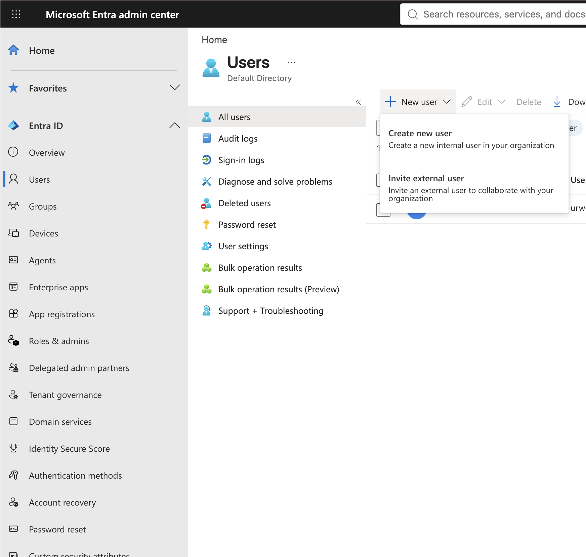
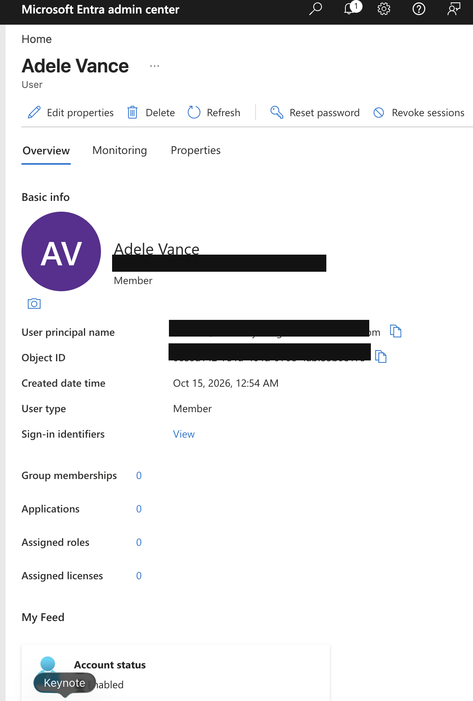
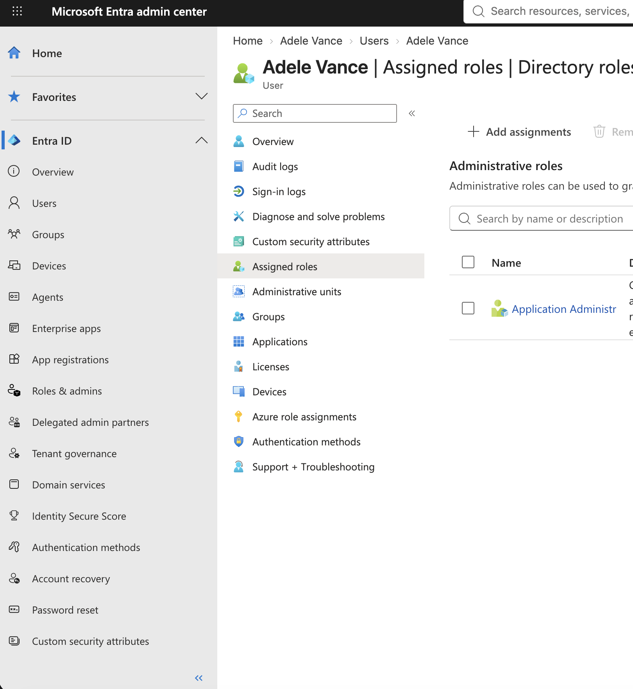
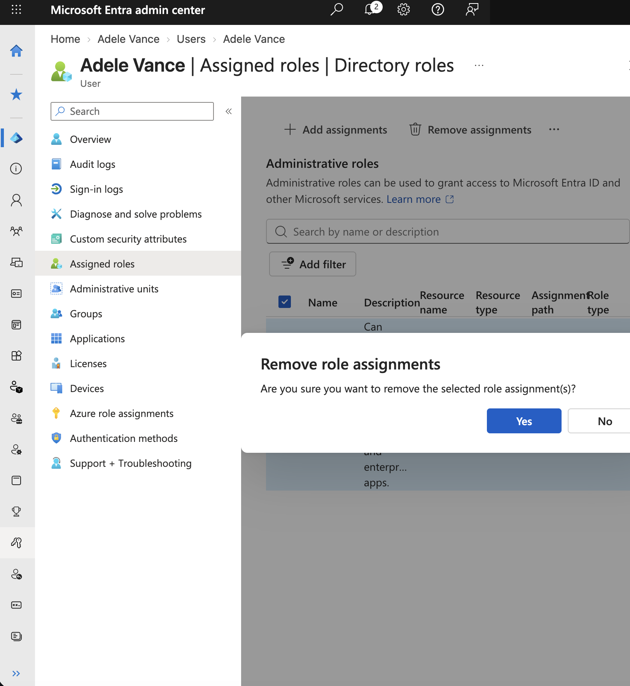
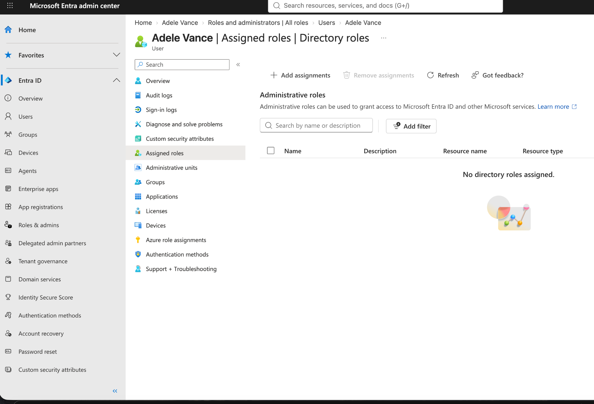

# Lab 01: Microsoft Entra ID User and Role Management

## Lab Overview

This hands-on lab demonstrates basic identity provisioning and administrative role management using Microsoft Entra ID. As part of my cybersecurity and IAM training, I created a test user account, assigned the Application Administrator role, and removed the role after completing the exercise.

## Lab Objectives

- Create a test user in Microsoft Entra ID.
- Assign the Application Administrator role.
- Review the user's assigned directory roles.
- Remove the administrative role when it is no longer needed.
- Verify that the user no longer has the assigned directory role.

## Tools Used

- Microsoft Entra admin center
- Microsoft Entra ID
- Azure for Students practice environment
- Microsoft Learn training exercise

## Security Concepts

**Identity Provisioning:** Creating and managing user accounts within an organization.

**Role-Based Access Control (RBAC):** Assigning permissions through predefined roles rather than granting unrestricted access.

**Least Privilege:** Granting only the access necessary to perform an authorized task and removing elevated permissions when they are no longer required.

## Lab Screenshots

### Step 1: Navigate to Create New User

### Step 2: Verify User Account Creation

### Step 3: Assign Application Administrator Role

### Step 4: Remove Administrator Role

### Step 5: Verify Role Removal

  
