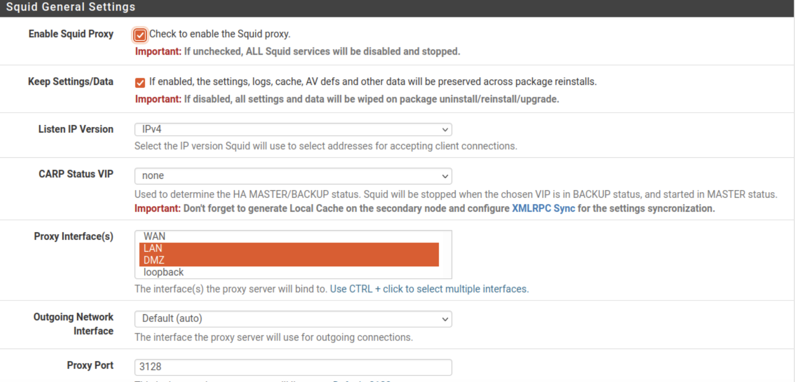
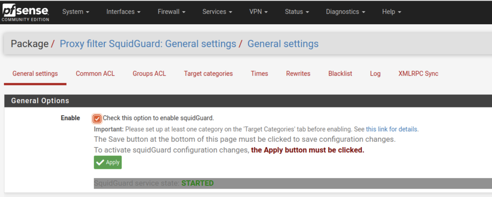
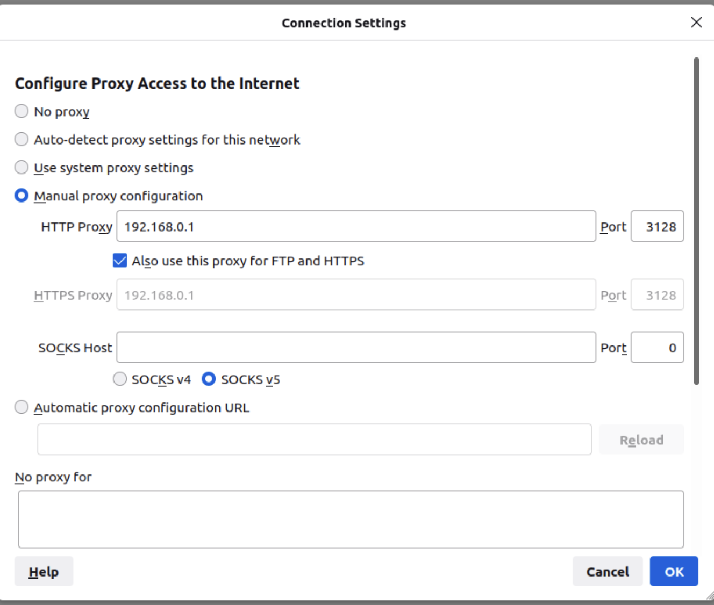
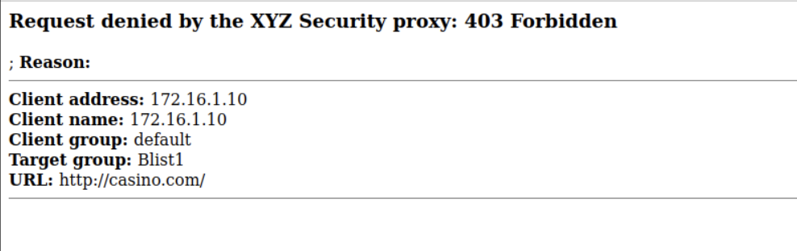

# pfSense Proxy and Web Filtering

## Project Overview

This project demonstrates how a network firewall and web proxy can be configured to manage and restrict access to websites. In a controlled lab environment, I worked with pfSense, Squid, and SquidGuard to configure proxy services and web filtering. I also configured Firefox to use the proxy and tested the filtering settings to verify that access to a website was blocked.

The purpose of this project was to gain hands-on experience with network security controls, web access restrictions, and the importance of enforcing organizational security policies.

## Project Objectives

The objectives of this project were to:

- Configure a Squid proxy server within pfSense to manage web traffic.
- Configure SquidGuard to apply website filtering and access restrictions.
- Configure Firefox to route web requests through the proxy server.
- Test website access to verify that the filtering configuration was working.
- Gain practical experience with network security controls and how organizations can use web filtering to enforce security policies.
## Tools and Technologies

- **pfSense:** Firewall and network security platform used to configure and manage proxy services.
- **Squid Proxy:** Proxy server software used to process web requests and manage web traffic.
- **SquidGuard:** URL filtering tool used to apply website access restrictions.
- **Mozilla Firefox:** Web browser configured to use the proxy server and test website filtering.
- **Virtual Lab Environment:** Isolated network environment used to safely configure and test security controls.
## Lab Configuration and Procedures

### 1. Squid Proxy Configuration

Configured the Squid proxy service within pfSense to manage web traffic in the virtual network environment.

### 2. SquidGuard Web Filtering

Configured SquidGuard to apply website access restrictions using web filtering rules and blacklist settings.

### 3. Firefox Proxy Configuration

Configured Mozilla Firefox to use the proxy server so browser requests could be processed through the configured proxy service.

### 4. Web Filtering Verification

Tested website access through Firefox and observed a blocked-access message, confirming that the filtering configuration restricted access to the tested website.
## Results and Observations

During the lab simulation, I configured the Squid proxy and SquidGuard web filtering settings within pfSense. I also configured Mozilla Firefox to communicate through the proxy server.

After applying the filtering configuration, I tested access to a restricted website and received a blocked-access message.

### Key Observations

- The proxy configuration allowed browser traffic to be directed through the configured proxy service.
- SquidGuard applied the website access restrictions during testing.
- The blocked-access message provided visible confirmation that the tested website was restricted.
- The exercise demonstrated how web filtering can support organizational security policies and reduce access to unwanted websites.
## Lessons Learned

Through this project, I gained a better understanding of how proxy servers and web filtering tools can help organizations manage network traffic and enforce security policies.

Key lessons from this exercise included:

- **Proxy Server Functionality:** Learned how Squid can act as an intermediary between a web browser and requested websites.
- **Access Control:** Gained practical experience configuring SquidGuard to restrict access to websites based on filtering rules.
- **Network Security:** Developed a better understanding of how pfSense can support network security through its firewall and proxy capabilities.
- **Security Verification:** Learned the importance of testing security configurations to confirm that access restrictions work as intended.
- **Defense in Depth:** Recognized how web filtering can complement other security controls to help protect organizational networks.
## Conclusion

This project provided hands-on experience configuring and testing web filtering security controls using pfSense, Squid, and SquidGuard in a controlled virtual environment.

By configuring a proxy server, applying website filtering restrictions, and verifying the results through Firefox, I gained a better understanding of how organizations can manage web access and enforce network security policies.

This exercise strengthened my practical knowledge of network security, access control, and the importance of validating security configurations. It also demonstrated how multiple security technologies can work together to support a defense-in-depth strategy.
## Lab Evidence

### 1. Squid Proxy Configuration

### 2. SquidGuard Configuration

### 3. Firefox Proxy Settings

### 4. Web Filtering Verification

